<picture>
  <source media="(prefers-color-scheme: dark)" srcset="./assets/breakdown-hero-dark.svg">
  
</picture>

<b>Shivam Kumar</b>

#### Comp script

<picture>
  <source media="(prefers-color-scheme: dark)" srcset="./assets/breakdown-script-dark.svg">
  
</picture>

Reading the breakdown

- **The shot:** one tower per day of the last 12 months and one row per week, laid out like the contribution calendar (Sunday on the left). A tower is as tall as that day was busy, relative to your busiest day. This week is nearest the camera; the oldest week recedes toward the sun.
- **The passes:** wireframe, clay, normals and depth are the render passes a CG artist checks before a shot goes out. The hero wipes through them to the final beauty pass, the way a breakdown reel does.
- **The timeline:** one frame per day, from frame 1001 (where shots start) to 1365. Bar heights are daily contributions, and the diamond marks your busiest day.
- **Comp script:** the year is the background plate. Featured repositories are Read nodes merged over it, each with a material preview in its language colour. The result is graded, then written out as version v067: one version for every active day.
- **Colour chart:** language share by bytes across public repositories, above a grey ramp.
- **The end card:** an on-set lighting reference kit, with a grey ball, a chrome ball reflecting the shot's sunset and a colour chart.

Artwork: original animated SVG, generated by README Templates · template: Breakdown. Motion stops if your system asks for reduced motion.

#### Credits

- **[travel-buddy1](https://github.com/Ashborne-lab/travel-buddy1)**  
  CSS · ★ 3
- **[Ashborne-lab](https://github.com/Ashborne-lab/Ashborne-lab)** · Config files for my GitHub profile.  
  ★ 2
- **[DDR](https://github.com/Ashborne-lab/DDR)**  
  Python · ★ 3
- **[MUJ_Nav](https://github.com/Ashborne-lab/MUJ_Nav)** · University navigation project  
  JavaScript · ★ 2

**Toolkit:** Python · HTML · JavaScript · TypeScript

<picture>
  <source media="(prefers-color-scheme: dark)" srcset="./assets/breakdown-end-dark.svg">
  
</picture>

