<picture>
  <source media="(prefers-color-scheme: dark)" srcset="./assets/hero-dark.svg">
  
</picture>

<picture>
  <source media="(prefers-color-scheme: dark)" srcset="./assets/year-dark.svg">
  
</picture>

### Projects

- **[KG_RAG](https://github.com/Ashborne-lab/KG_RAG)** · A lightweight, domain-agnostic hybrid knowledge-graph RAG for data retrieval. TypeScript
- **[Invistigation_agent-memory](https://github.com/Ashborne-lab/Invistigation_agent-memory)** Python
- **[DDR](https://github.com/Ashborne-lab/DDR)** Python
- **[MUJ_Nav](https://github.com/Ashborne-lab/MUJ_Nav)** · University navigation project. JavaScript

### Contact

[kumarshivam42712@gmail.com](mailto:kumarshivam42712@gmail.com)

The artwork is two hand-written animated SVGs, redrawn every day from my public contribution calendar by <a href="./scripts/generate.py">scripts/generate.py</a>. Motion stops if your system asks for reduced motion.
